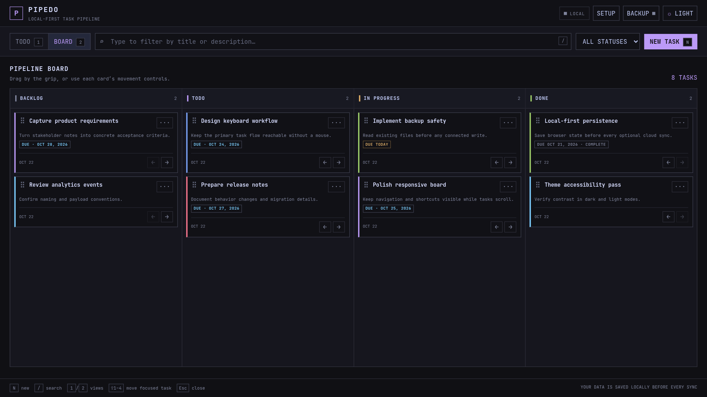

# PIPEDO

<p align="center">
  
</p>

PIPEDO is a lightweight, local-first productivity app that combines a Todo list and a four-stage Kanban board in one portable web page.

It is designed for keyboard-first task management with an Omarchy-inspired interface: sharp geometry, monospace typography, restrained color, minimal visual noise, and dark and light themes.

**Live repository:** https://github.com/estebanbocic/pipedo

## Preview



The application runs as a single browser viewport: the task area scrolls independently while navigation, synchronization state, and keyboard shortcuts remain visible.

## What PIPEDO does

- Manages tasks in **Todo** and **Kanban** views.
- Uses one shared task collection across both views.
- Organizes work into **Backlog**, **Todo**, **In Progress**, and **Done**.
- Stores data locally before attempting cloud synchronization.
- Optionally synchronizes tasks with Supabase.
- Exports, imports, and continuously updates portable JSON backup files.
- Works without a build step, package manager, application server, or installed dependencies.

## Features

### Task management

Each task contains:

- Title
- Description
- A checklist of completable subitems
- Status
- Color
- Optional due date
- Creation and update timestamps

Available task colors:

- Neutral
- Tokyo blue
- Tokyo cyan
- Tokyo violet
- Tokyo pink
- Tokyo green

Due dates receive clear visual states:

- Future due date
- Due today
- Overdue
- Completed

Completed tasks are never presented as overdue.

### Todo view

The Todo view provides a compact list for quickly reviewing and changing tasks.

- Mark tasks complete with the checkbox.
- Complete or reopen individual subitems without completing the parent task.
- Change status directly from the status selector.
- Edit title, description, subitems, status, color, and due date.
- Filter by status.
- Search by title, description, or subitem text.

### Kanban view

The Kanban board contains four columns:

1. Backlog
2. Todo
3. In Progress
4. Done

Tasks can be moved and reordered by:

- Dragging a card within a column to change its order.
- Dragging a card between columns to place it at a specific position.
- Using the left and right movement buttons.
- Focusing a task and pressing `Shift+1` through `Shift+4`.

The board is framed inside the application viewport. Task scrolling remains inside the board while the header, controls, and keyboard shortcut footer stay visible.

### Search and filters

The search field filters tasks immediately by title, description, or subitem text. Search works in both Todo and Kanban views.

The status filter supports:

- All statuses
- Active
- Backlog
- Todo
- In Progress
- Done

### Themes

PIPEDO includes:

- A dark Tokyo Night-inspired theme.
- A high-contrast light theme.
- Purple interface accents in both themes.
- A persistent theme preference stored in the browser.
- Reduced-motion support through `prefers-reduced-motion`.

Use the theme button in the upper-right corner to switch themes.

## Keyboard shortcuts

Shortcuts are disabled while typing in a field or while a dialog is open.

| Shortcut | Action |
| --- | --- |
| `N` | Create a new task |
| `/` | Focus search |
| `1` | Open Todo view |
| `2` | Open Kanban view |
| `Shift+1` | Move the focused task to Backlog |
| `Shift+2` | Move the focused task to Todo |
| `Shift+3` | Move the focused task to In Progress |
| `Shift+4` | Move the focused task to Done |
| `Esc` | Close the active dialog |

Click a task's non-interactive area or reach it with `Tab` to focus it. The selected task is marked with an accent border and active-surface highlight. Focus follows a task when it moves, allowing several status shortcuts without selecting it again.

## Quick start

### Option 1: Open the file directly

Clone or download the repository, then open `index.html` for the landing page or `app.html` to open PIPEDO directly.

```bash
git clone https://github.com/estebanbocic/pipedo.git
cd pipedo
```

Direct file access supports task management, LocalStorage, manual JSON export, and manual JSON import. Some browsers restrict automatic file access when an app is opened through a `file://` URL.

### Option 2: Serve the files locally — still browser-only

PIPEDO does not use Python as an application runtime or backend. The following command only asks Python to expose the files in the current directory over local HTTP:

```bash
python3 -m http.server 8080
```

Then open the landing page or application:

```text
http://localhost:8080/
http://localhost:8080/app.html
```

All application code still executes in the browser. Tasks remain in browser LocalStorage, the browser talks directly to Supabase when configured, and the browser reads or writes connected backup files.

Serving the files through `localhost` is useful because it provides a stable web origin and avoids restrictions that some browsers apply to `file://` pages. Chromium also treats localhost as a secure context, which enables the File System Access API used for automatic connected-file backups.

Python is not required. Any static-file server, GitHub Pages, or another static host works. You may also open `index.html` or `app.html` directly if you only need the features supported by your browser for local files.

Stopping the command only makes `http://localhost:8080` unavailable; it does not delete browser tasks or backup files. There is no build command and no PIPEDO server process.

## Local-first storage

PIPEDO always writes task state to browser LocalStorage first.

Storage keys:

- `pipedo.tasks.v1` — tasks, deletion tombstones, and pending reconciliation state.
- `pipedo.preferences.v1` — selected view, status filter, and theme.

This means the app remains usable when:

- Supabase is not configured.
- Supabase credentials are invalid.
- The Supabase JavaScript CDN is unavailable.
- The network is offline.

LocalStorage belongs to the current browser profile and origin. For example, `file://`, `http://localhost:8080`, and a deployed HTTPS site may each have separate browser storage.

## Backup and restore

Open **BACKUP** from the header to manage portable JSON files.

### Backup indicator

The LED beside **BACKUP** reports file state:

- Gray — no writable backup file connected.
- Amber — changes are waiting to be written.
- Green — the connected file contains the current task state.
- Red — the latest file write failed.

A connected file is updated:

- Immediately after task changes.
- After imports or cloud merges.
- Once every minute while file permission remains available.

Local task state remains intact if a file write fails.

### Open and connect an existing backup

Choose **OPEN & CONNECT**.

PIPEDO reads and validates the selected file before writing anything. This operation combines restore and automatic backup connection without silently replacing file contents.

### Create a new backup

Choose **CREATE NEW** and select a new empty JSON file.

PIPEDO refuses to overwrite a non-empty file through this action. Existing files must be opened with **OPEN & CONNECT** so their contents can be read safely first.

### Merge versus replace

The restore mode applies to both connected files and manual imports.

#### Merge — keep current tasks

This is the default and safest mode.

- Every current task is preserved.
- Missing tasks from the backup are added.
- Current tasks win ID conflicts.
- Backup deletion records cannot remove current tasks.

#### Replace — use only backup tasks

This mode replaces the current task collection with the backup contents.

- PIPEDO displays an explicit destructive confirmation.
- Canceling changes neither browser data nor file contents.
- If Supabase is configured, the replacement is reconciled to the cloud.

### Manual export and import

Manual operations work even when automatic file access is unavailable:

- **EXPORT JSON** downloads a timestamped backup.
- **IMPORT FILE** restores a backup using the selected Merge or Replace mode.

The current backup format is version 3. Version 1 and 2 backups remain importable; missing colors, due dates, and subitems are added with safe defaults.

## Optional Supabase synchronization

PIPEDO is fully functional without Supabase.

### 1. Create a Supabase project

Create a project at https://supabase.com and open its SQL editor.

### 2. Create the database table

Open PIPEDO, choose **SETUP**, and copy the SQL shown in the setup dialog. Run it in the Supabase SQL editor.

The SQL creates or updates the `tasks` table with fields for:

- Task identity
- Title and description
- Subitems and their completion state
- Status
- Color
- Due date
- Sort position
- Creation and update timestamps

### 3. Configure the client

Edit `config.js`:

```js
window.PIPEDO_CONFIG = {
  supabaseUrl: 'https://YOUR_PROJECT.supabase.co',
  supabaseAnonKey: 'YOUR_ANON_OR_PUBLISHABLE_KEY',
  tableName: 'tasks'
};
```

Leave the URL or key empty to use local-only mode.

The app loads the standard Supabase JavaScript client from the jsDelivr CDN. If loading or connecting fails, PIPEDO remains in local mode.

### Synchronization behavior

- Local state is available immediately.
- Remote and local tasks are merged by task ID and update timestamp.
- Deletion tombstones prevent older cloud records from restoring deleted tasks.
- Local changes are queued for Supabase when cloud synchronization is available.
- A full Replace restore queues cloud reconciliation so Supabase matches the restored state.

The status indicator in the header reports local, connecting, cloud-synced, offline, or error state.

## Supabase security warning

The SQL included in the app uses permissive demo Row Level Security policies so an anonymous client can read and modify tasks.

That configuration is appropriate only for a personal demo or trusted environment. Anyone with the public project URL and anonymous key may be able to access the table.

Before exposing real or sensitive data:

1. Add Supabase Authentication.
2. Add an owner/user ID column to tasks.
3. Replace the demo policies with user-scoped policies.
4. Test read, insert, update, and delete isolation between users.

Supabase anonymous or publishable keys are designed to be visible in browser code. Security must be enforced by database policies, not by trying to hide the browser key.

Never commit service-role keys or other privileged credentials.

## Browser support

Core task management works in current versions of Chrome, Chromium, Edge, Firefox, and Safari when LocalStorage and standard JavaScript are enabled.

Automatic connected-file backup depends on the File System Access API and a secure context. It works best in Chromium-based browsers on:

- `http://localhost`
- HTTPS deployments

Browsers without that API can still use manual JSON export and import.

## Deploying as a static site

PIPEDO can be hosted by any static-file provider because it has no server-side runtime.

Examples:

- GitHub Pages
- Cloudflare Pages
- Netlify
- Vercel
- An nginx or Apache static directory

For GitHub Pages:

1. Open the repository's **Settings**.
2. Select **Pages**.
3. Choose **Deploy from a branch**.
4. Select the `main` branch and `/ (root)` directory.
5. Save the configuration.

If using Supabase from a deployed domain, verify that the database policies are appropriate for public access.

## Project structure

```text
pipedo/
├── index.html   # Public landing page
├── app.html     # Complete task application
├── config.js    # Optional Supabase connection configuration
├── README.md    # Project documentation
└── .gitignore   # Excludes personal backups and local secrets
```

Runtime dependencies are loaded from CDNs:

- JetBrains Mono from Google Fonts.
- Tailwind CSS browser script.
- Supabase JavaScript client.

The landing page is contained in `index.html`. The task application’s interface styling and behavior are contained in `app.html`.

## Privacy notes

- Local tasks remain in the current browser profile unless exported or synchronized.
- JSON backups contain task titles, descriptions, subitems, dates, statuses, colors, IDs, and deletion metadata.
- Treat backup files as personal data.
- `pipedo-backup*.json` and `secrets.js` are excluded by `.gitignore`.
- Clearing browser site data removes LocalStorage unless a JSON or cloud backup exists.

## Troubleshooting

### Tasks are not appearing in another browser or URL

LocalStorage is scoped to a browser profile and origin. Export a JSON backup, configure Supabase, or use the same origin.

### The backup LED is gray

No writable file is connected. Open **BACKUP**, then choose **OPEN & CONNECT** or **CREATE NEW**.

### The backup LED is amber

A file write is queued or in progress. Keep the page open until it turns green.

### The backup LED is red

The browser could not write the connected file. Open **BACKUP** and review the status message. Use **SAVE NOW** to re-authorize a previously read file or **OPEN ANOTHER** to select a different backup.

### Automatic backup controls are unavailable

Use a Chromium-based browser and serve the app from localhost or HTTPS. Manual export and import remain available.

### Supabase is not connecting

Check:

- `supabaseUrl` and `supabaseAnonKey` in `config.js`.
- The configured table name.
- Whether the SQL from **SETUP** has been applied.
- Browser network access to the Supabase CDN and project.
- Supabase table permissions and Row Level Security policies.

Local task management continues to work while Supabase is unavailable.

### A keyboard shortcut does not run

Shortcuts intentionally do not run while focus is inside an input, textarea, select, editable field, or open dialog. Click a task or an empty interface area first.

## Development

There is no compilation pipeline or backend. Edit `index.html`, `app.html`, or `config.js`, refresh the browser, and test the affected interaction.

For local development, any static server can expose the files to the browser. For example:

```bash
python3 -m http.server 8080
```

This Python process only serves static files; PIPEDO still runs entirely in the browser.

Keep the application portable:

- Avoid build-only dependencies.
- Keep landing content in `index.html` and application behavior in `app.html`.
- Keep optional deployment configuration in `config.js`.
- Do not commit task backup files or privileged credentials.
